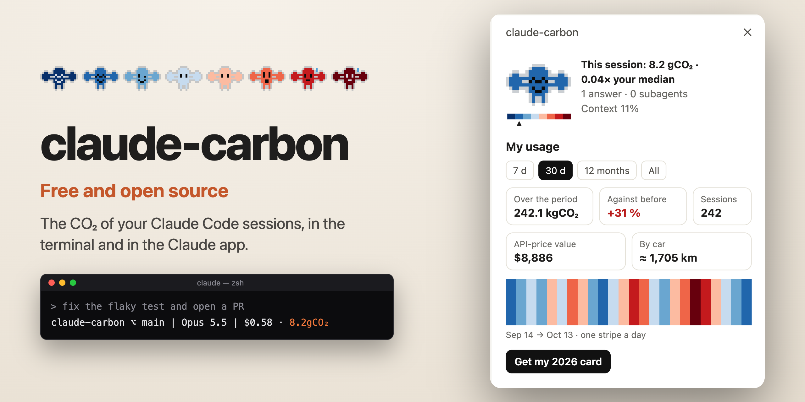
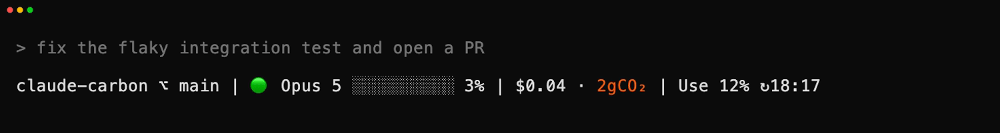
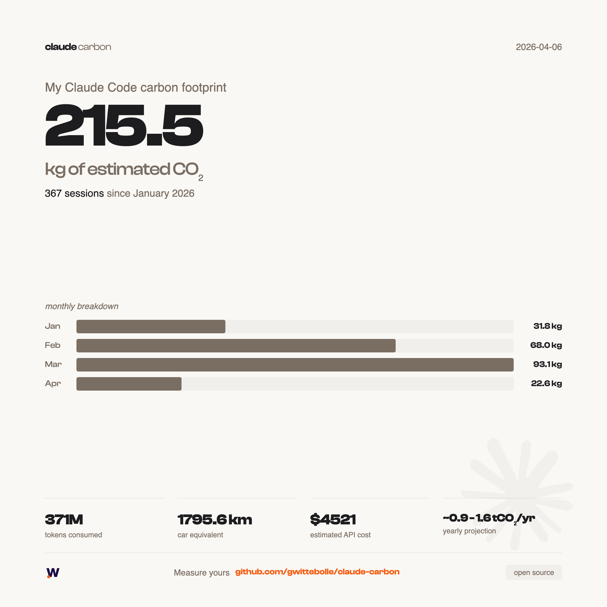
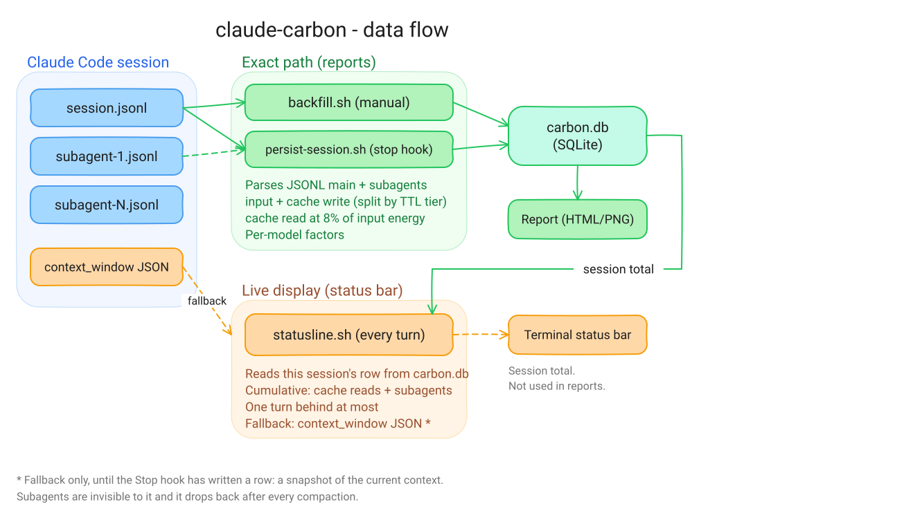

<p></p>

[](https://github.com/gwittebolle/claude-carbon/stargazers)
[](LICENSE)
[](https://github.com/gwittebolle/claude-carbon/releases)
[](https://www.npmjs.com/package/claude-carbon)
[](https://github.com/gwittebolle/claude-carbon/actions/workflows/ci.yml)

claude-carbon is an open source Claude Code plugin that tracks the carbon footprint of your sessions: a live CO2 estimate computed locally from your token usage, in the terminal status line and in the Code tab of the Claude desktop app, next to the session's API-equivalent cost. In the desktop app, `/carbon-panel` opens a pane with a pixel molecule coloured by this session's CO2 against the median of your past sessions, your usage over the period you pick, its warming stripes, and a button for your yearly card.

## What claude-carbon does

- `/carbon-panel`: a pane in the Claude desktop app with your CO2 molecule, your usage and the warming stripes of your sessions (in a terminal, the session in the band above the prompt). See [the mod](#the-mod-carbon-panel-and-the-co2-of-each-answer)
- Adds a live CO2 estimate to the Claude Code status line, and the session's CO2 under the prompt in the Claude desktop app, each next to the session's API-equivalent cost
- Persists each session to a local SQLite database, so history survives the 30-day transcript purge
- Backfills historical data from existing `~/.claude` transcripts
- Slash commands: `/carbon-report` (text), `/carbon-card` (PNG), `/carbon-pr` (footprint of a pull request)
- A README badge with your all-time total, and a public methodology with every factor sourced

> **About the `$` figure.** It is an API equivalent: what your session would cost at Anthropic's pay-as-you-go API list prices. On a Pro or Max subscription you do not pay it; it shows the value of what you used, next to its CO2. See [How it works](#how-it-works).

## Install

Two ways, same result. Pick the one that fits you:

- **Not a developer, or you use the Claude desktop app:** [let Claude install it for you](#option-1-from-the-claude-desktop-app-no-terminal). No terminal, one message to paste.
- **Developer, at ease in a terminal:** [one command](#option-2-from-a-terminal-developers).

Already installed? See [Updating](#updating).

### Option 1: from the Claude desktop app (no terminal)


1. Open the **Code** tab of the Claude desktop app and start a session, in any folder.
2. Paste the message for your system. It works in any language. Claude runs the installer for you and asks before running the command: accept.

   macOS or Linux:

   ```text
   Install claude-carbon for me by running this command:
   curl -fsSL https://raw.githubusercontent.com/gwittebolle/claude-carbon/main/install.sh | bash
   ```

   Windows:

   ```text
   Install claude-carbon for me by running this command in PowerShell:
   irm https://raw.githubusercontent.com/gwittebolle/claude-carbon/main/install.ps1 | iex
   ```

3. Quit the desktop app completely, open it again, and start a new session in the Code tab. Under the prompt you now see `This session: 3.6 gCO₂ · $0.12` (`Cette session : 3,6 gCO₂ · 0,12 $` in French). `/carbon-report` and `/carbon-card` work from there too.

   The `$` is an API-equivalent cost, not what your subscription bills.

**If the install stops**

- **macOS opens a window about "command line developer tools".** That is `git`, which the installer needs and a Mac without developer tools does not have yet. Click **Install**, wait until it finishes (a few minutes), then tell Claude: "Run the claude-carbon install again."
- **"jq is not installed" or "sqlite3 is not installed".** Tell Claude: "Install what is missing, then run the claude-carbon install again." Every Mac has `sqlite3`, and macOS 15 and later also have `jq`; on an older Mac the installer fetches the official `jq` itself, checked against its published checksum. On Windows the installer prints the `winget` command to use.
- **Windows says Git Bash is missing.** Install [Git for Windows](https://git-scm.com/downloads/win) (Claude Code needs it on Windows anyway), reopen the app, and ask Claude again.

The chat and Cowork tabs are not covered: their sessions run on Anthropic's servers, so nothing reaches your machine to count.

### Option 2: from a terminal (developers)



**1. Install (or update):**

macOS, Linux, WSL:

```bash
curl -fsSL https://raw.githubusercontent.com/gwittebolle/claude-carbon/main/install.sh | bash
```

Windows (PowerShell), which needs [Git for Windows](https://git-scm.com/downloads/win) and two packages first - see [Windows](#windows):

```powershell
irm https://raw.githubusercontent.com/gwittebolle/claude-carbon/main/install.ps1 | iex
```

Or, on any platform with Node.js:

```bash
npx claude-carbon
```

Same command to install and to update to the latest version (all three run the same installer).

> **Installed from Anthropic's community marketplace and the plugin fails to load?** The `co2-tracker@claude-community` entry is pinned to a release from August 2026 that current Claude Code rejects ("Duplicate hooks file detected"). Run `/plugin uninstall co2-tracker@claude-community`, then install with one of the commands above.

**2. Restart Claude Code.** Your CO2 appears in the status line:

```
claude-carbon ⌥ main | 🟢 Opus 5 ▓▓▓░░░░░░░ 35% | $0.50 · 65gCO₂ | Use 24% ↻13:00
```

Segments, left to right: project + git branch, model + context window %, API-equivalent session cost + CO2, 5h block usage % + reset time. A 🔥 prefix appears when the sustained burn rate would overshoot 100% of the limit by the end of the 5h block (after a 15 min grace window, only once usage reaches 15%).

> **Where the CO2 shows up.** The status line is a feature of the Claude Code terminal UI. It is displayed only when you run `claude` in a terminal, including the integrated terminal of VS Code or JetBrains. The IDE extensions' chat panel has no status line at all, so nothing is displayed there even though the hooks still run and your sessions are recorded: `/carbon-report` covers them. If you use the VS Code panel and want the live CO2, open a terminal in VS Code (`` Ctrl+` ``) and run `claude` from there. The web app (claude.ai/code) runs neither the status line nor the hooks, so nothing is displayed or recorded there. The desktop app does not display the status line either; the plugin's [mod](#the-mod-carbon-panel-and-the-co2-of-each-answer) draws the CO2 in its Code tab.

**5h quota source.** The percentage comes directly from Anthropic's `/api/oauth/usage` endpoint (the same data Claude Code displays in `/usage`). No heuristic, no token-limit file to seed. Two sources in order:

1. **stdin** (preferred): if Claude Code injects `rate_limits.five_hour.used_percentage` in the statusline JSON, that value is used straight away.
2. **OAuth API fallback**: `GET https://api.anthropic.com/api/oauth/usage` with the bearer token from macOS Keychain, `CLAUDE_CODE_OAUTH_TOKEN`, or `~/.claude/.credentials.json`. Cached 60s in `~/.claude/claude-carbon/oauth-usage.json`.

Accurate on every plan, including Max 20x.

**3. Use the slash commands:**

- `/carbon-report` - text report with totals, a car equivalent, this year's share of a 2 t per-person budget, top sessions
- `/carbon-card` - generate shareable PNG report cards (PNG export needs `playwright-core`, see [Dependencies](#dependencies); without it the card opens in your browser)
- `/carbon-update` - update to the latest version and re-price history (see [Updating](#updating))

## Example report

<p align="center">
  
</p>

Generate yours with `/carbon-card` in Claude Code. The summary and detailed PNGs land in
`~/Downloads/claude-carbon/` (the Windows Downloads folder follows the system setting, so a
OneDrive-redirected one is honoured) and the folder opens in your file manager, with the
card selected on macOS. `CLAUDE_CARBON_EXPORT_DIR` picks another folder;
`CLAUDE_CARBON_NO_OPEN=1` skips the opening.

Without Playwright or Chromium there is no PNG and the command still finishes: the summary
card is saved as an HTML page in the same folder and opens in your browser, scaled to fit the
window, and a screenshot of it does the job.
The card's footer says where to find the tool, `claude-carbon sur GitHub` / `claude-carbon on GitHub`, with the address below it.

From the 1st to the 10th of each month the status line ends with `📊 September: 84.2kgCO₂ · /carbon-card`:
the total of the month just closed, the bar the card draws for it, in the same format as the
session figure. It is read from carbon.db once a day while the nudge shows, and kept in
`~/.claude/claude-carbon/last-month-total`. A month with fewer than 7 days of sessions gets no
nudge, so a fresh install is not pushed to share a near-empty card. Generating a card
clears it for the month; it goes quiet on its own after the 10th. `CLAUDE_CARBON_CARD_NUDGE_UNTIL_DAY`
moves the cut-off, `CLAUDE_CARBON_NO_CARD_NUDGE=1` removes the nudge. Nothing is posted anywhere:
sharing stays a human decision.

<details>
<summary>Advanced options (CLI)</summary>

```bash
# Since a specific date
bash ~/code/claude-carbon/scripts/generate-report.sh --since 2026-03-01

# All time
bash ~/code/claude-carbon/scripts/generate-report.sh --all

# A closed period (--until is an exclusive upper bound: this one stops at June 30th)
bash ~/code/claude-carbon/scripts/generate-report.sh --since 2026-01-01 --until 2026-07-01
```

</details>

<details>
<summary>Custom install directory</summary>

```bash
curl -fsSL https://raw.githubusercontent.com/gwittebolle/claude-carbon/main/install.sh | CLAUDE_CARBON_DIR=~/my-path/claude-carbon bash
```

The env var has to sit on the `bash` side of the pipe, not the `curl` side, or the installer never sees it.

</details>

<details>
<summary>Second Claude environment (CLAUDE_CONFIG_DIR)</summary>

If you run a second Claude Code environment out of its own config directory, e.g.

```bash
alias claude-work="CLAUDE_CONFIG_DIR=~/.claude-work claude"
```

install claude-carbon into that same directory by passing `CLAUDE_CONFIG_DIR` to the installer:

```bash
curl -fsSL https://raw.githubusercontent.com/gwittebolle/claude-carbon/main/install.sh | CLAUDE_CONFIG_DIR=~/.claude-work bash
```

The status line, the hooks, the database and the `/carbon-*` commands all live under that config dir, so each environment tracks its own sessions independently. When `CLAUDE_CONFIG_DIR` is unset everything falls back to `~/.claude` as before.

</details>

<details>
<summary>Manual install</summary>

```bash
git clone https://github.com/gwittebolle/claude-carbon.git ~/code/claude-carbon
bash ~/code/claude-carbon/scripts/setup.sh
bash ~/code/claude-carbon/scripts/configure-settings.sh
```

The second script merges the block below into `~/.claude/settings.json` (additively: an existing status line or third-party hooks are left alone) and symlinks the `/carbon-*` commands. To wire it by hand instead, skip it and add:

```json
{
  "statusLine": {
    "type": "command",
    "command": "~/code/claude-carbon/scripts/statusline.sh"
  },
  "hooks": {
    "Stop": [
      {
        "matcher": "",
        "hooks": [
          {
            "type": "command",
            "command": "~/code/claude-carbon/scripts/persist-session.sh"
          }
        ]
      }
    ],
    "SessionEnd": [
      {
        "matcher": "",
        "hooks": [
          {
            "type": "command",
            "command": "~/code/claude-carbon/scripts/persist-on-exit.sh"
          }
        ]
      }
    ],
    "SessionStart": [
      {
        "matcher": "",
        "hooks": [
          {
            "type": "command",
            "command": "~/code/claude-carbon/scripts/safety-rescan.sh"
          }
        ]
      }
    ]
  }
}
```

The `Stop` hook records the session after each turn, and `SessionEnd` records it once more as it closes, so a last turn interrupted before `Stop` fired is still counted. The `SessionStart` one re-scans for sessions both missed (crash, kill) and drives the daily update check the status line reads; without it you are never told a new version exists.

Restart Claude Code.

</details>

## For teams

claude-carbon measures one developer's sessions, locally. If the question comes from your CTO, a client RFP or a CSR committee, the same methodology exists as a hosted layer:

- [Free calculator](https://tokenclimate.com/en/calculator?ref=github) and [per-model factor sheets](https://tokenclimate.com/en/models?ref=github) - the exact versioned factors of this repo, browsable.
- [AI usage report](https://tokenclimate.com/bilan/en?ref=github) - a self-serve, shareable report of your organisation's real Claude usage (cost, CO2e, water, energy), generated in minutes from an Anthropic admin key. The key is never stored; the methodology annex is citation-ready.
- [TokenClimate](https://tokenclimate.com/en?ref=github) - hosted team dashboards. Both sides share this repo's golden vectors, verified weekly in CI.

The only places the OSS points there are a one-line footer in `/carbon-report` and a small credit on the `/carbon-card` PNGs. No status-line promo, no email capture: nothing leaves your machine.

### PR dev footprint (/carbon-pr)

The number reviewers rarely see is what the PR cost to develop: your local Claude Code sessions while building the branch. `/carbon-pr` (or `scripts/generate-pr-report.sh`) sums the recorded sessions of the current branch and posts one sticky comment on its open PR, through your own `gh` auth. Run it after your push; running it again updates the same comment in place.

```
**Claude Code carbon report** · developing this PR
124 g CO2e · $3.00 · 180k tokens · 1.5M cache reads · 2 sessions
```

How the sessions are attributed: the Stop hook stores each session's git branch (read from the transcript), and the report selects `project + branch`. Sessions recorded before this column existed carry no branch; `scripts/backfill.sh` repairs them while their transcripts are still on disk (about 30 days). A session whose last folder is a subdirectory of the repo is stored under the subdirectory's name and stays out of the sum. A session that ends on another branch than it started is attributed to where it finished.

Turning it off is the default: nothing is posted unless you run it. `--dry-run` previews the comment, `--pr <number>` targets a specific PR, and deleting the comment on GitHub is the full cleanup.

## How it works



**Three data paths, two levels of accuracy:**

| Script               | Trigger                 | Data source           | Subagents    | Cache reads         | Accuracy      |
| -------------------- | ----------------------- | --------------------- | ------------ | ------------------- | ------------- |
| `backfill.sh`        | Manual / setup          | JSONL files           | Included     | Counted (8% energy) | Best estimate |
| `persist-session.sh` | Stop + SessionEnd hooks | JSONL files           | Included     | Counted (8% energy) | Best estimate |
| `statusline.sh`      | Every turn (live)       | `carbon.db` row       | Included     | Counted (8% energy) | One turn late |

**backfill** and **persist-session** parse the raw JSONL transcripts (main session + subagent files), applying per-model emission factors. They deduplicate assistant messages by `(message.id, requestId)`, so resumed and compacted sessions are not double-counted (this matches `ccusage`; without it the token sum inflates roughly 3x). Each session stores its raw token breakdown (input, cache write, cache read, output), which feeds the SQLite database used by reports.

**Cost** is the theoretical API list value (pay-as-you-go), not your subscription price: input, output, cache write, and cache read (0.1x input) at current Anthropic rates, set in `data/prices.json`. Cache writes are billed per TTL tier, 1.25x input for the 5-minute tier and 2x for the 1-hour one; each session's split is read from its transcript rather than assumed (Claude Code writes at the 1-hour tier). On deduplicated data it matches `ccusage`.

**statusline** reads this session's row from `carbon.db` at each turn, so the CO2 it shows is the session total on the same basis as the reports, one turn behind at most. Before that row exists (first turn, or no database yet) it falls back to an estimate from `context_window.total_input_tokens`, which is the size of the current context rather than a running total: subagents are invisible to it and every compaction sends it back down. Either way the status line displays, it never feeds the reports.

### Surviving the 30-day transcript purge

Claude Code deletes JSONL transcripts after about 30 days, so the SQLite database is the durable record. The `Stop` and `SessionEnd` hooks capture each session before its transcript ages out, and a once-a-day background re-scan (`SessionStart` hook, `safety-rescan.sh`) catches any session they missed while its transcript still exists, including one whose transcript kept growing after its row was written. Because each row stores raw token counts, `recompute.sh` regenerates cost and CO2 from `data/factors.json` + `data/prices.json` at any time, with no transcript needed. When Anthropic changes a price or a factor is revised, edit the config and run:

```bash
bash scripts/recompute.sh
```

Sessions recorded since September 2026 are re-derived model by model, exactly. Older sessions without a per-model split keep their stored values; `--include-unsplit` re-derives them at their dominant model, an approximation (see METHODOLOGY.md, "Surviving the 30-day transcript purge").

## Commands

| Command          | What it does                                        |
| ---------------- | --------------------------------------------------- |
| `/carbon-report` | Text report with totals, car equivalent, share of a 2 t budget, top sessions |
| `/carbon-card`   | Generate shareable PNG report cards                 |
| `/carbon-badge`  | Shields.io badge of your total footprint for your READMEs |
| `/carbon-pr`     | Post the dev footprint of the current branch on its PR |
| `/carbon-update` | Update to the latest version and re-price history   |

<details>
<summary>Scripts (run automatically, rarely needed manually)</summary>

| Script               | What it does                                                                              |
| -------------------- | ----------------------------------------------------------------------------------------- |
| `setup.sh`           | Init database, backfill historical sessions, show total                                   |
| `statusline.sh`      | Status line script (called automatically by Claude Code)                                  |
| `persist-session.sh` | Stop hook (saves session data after each turn)                                            |
| `persist-on-exit.sh` | SessionEnd hook (saves the session once more as it closes, in the background)             |
| `safety-rescan.sh`   | SessionStart hook (throttled background re-scan, catches missed sessions)                 |
| `backfill.sh`        | Re-parse all historical JSONL transcripts (incl. subagents)                               |
| `recompute.sh`       | Re-derive cost/CO2 from stored tokens after a price/factor change (no transcripts needed) |
| `generate-report.sh` | Export PNG report cards (CLI, with `--since` / `--until` / `--all`)                                   |
| `generate-badge.sh`  | Print the shields.io badge markdown + URL (CLI)                                           |
| `generate-pr-report.sh` | Post the branch's dev footprint on its PR (CLI, `--dry-run` / `--pr`)                  |

Note: backfill now derives project names from the transcript's `cwd` (matching the live hook). Sessions backfilled before this change keep their old, possibly truncated names; delete those rows and re-run `backfill.sh` to normalize them.

</details>

## Badge

`/carbon-badge` prints a ready-to-paste shields.io badge with your measured all-time footprint and the month it was taken, clickable to the methodology:

[](https://github.com/gwittebolle/claude-carbon/blob/main/METHODOLOGY.md)

<sub>That badge is live, not a mockup: the author's own total, 1,208 sessions measured between 15 January 2026 and 16 September 2026. It is one developer's footprint, not the project's.</sub>

```markdown
[](https://github.com/gwittebolle/claude-carbon/blob/main/METHODOLOGY.md)
```

The badge is a static image built from your local database, so the number is measured, not estimated on the fly, and nothing is sent anywhere. The month in the message says how old the figure is; re-run `/carbon-badge` whenever you want to refresh both.

It is one developer's total, so it belongs in your profile README or a personal project. In a team or organisation repository, reviewers will ask what produced the number and why it links out of the organisation, and they will be right to.

Numbers follow the locale the report uses (`fr` prints `12,4 kg`, `us` and the world default print `12.4 kg`); `CLAUDE_CARBON_LOCALE` forces a set.

## The mod: /carbon-panel and the CO2 of each answer

The claude-carbon plugin also holds a [Claude Code mod](https://code.claude.com/docs/en/plugins/mods/overview) that shows the CO2 of each answer when it ends, computed locally with the same formula and factors as the status line, and the session's total with its API-price cost.

- **Terminal**, including the integrated terminal of an editor and the JetBrains plugin: at the right end of the line that closes each answer, `✻ Worked for 38s · done 10:32 PM          16 gCO₂`. A line keeps its own answer's figure when it is drawn again (a resize, a scroll, ctrl+o); a line drawn for the first time later, such as one only ctrl+o shows, gets no figure.
- **Desktop app, Code tab**: a line under the answer, only for an unusual answer.
- **An unusual answer** shows the ratio, and the subagents' share when they weighed on it: `230 gCO₂ · 14× your median`. An answer is unusual when it is above the 97th percentile of your last 200 answers, over 3× their median and at least 10 g, which is about one answer in 27; none is flagged before 50 answers are recorded.
- **The session total** is pinned under the prompt, CO2 and API-price cost: `This session: 142 gCO₂ · $3.41`, in French `Cette session : 142 gCO₂ · 3,41 $`. It shows unless the claude-carbon status line already gives it or the `showSessionTotal` option is off (both in a terminal only, see [ccstatusline](#using-with-ccstatusline)). The cost is the pay-as-you-go API list price of the same requests as the CO2, from `data/prices.json` with the formula of `/carbon-report`, cache writes at the 1-hour tier Claude Code uses; under a cent it reads `< $0.01`, and it is left out when the price list cannot be read, then until the total starts over, so the cost never covers only part of the requests. It is what the usage would cost on the API, not what a subscription bills. Background subagents, which is how Claude Code starts most of them, count in the session total only: never in an answer, nor in your median. A foreground subagent counts in the answer that started it, not in the next one.
- **`/carbon-panel` opens a pane** with the mascot, a pixel CO2 molecule. Its colour compares this session with the median of your past sessions, from dark blue (under an eighth of it) to dark red (over eight times it). Until 10 sessions are recorded it compares with a starting reference of 0.5 kgCO₂ instead, so it has a colour from the first answer. It hops a pixel up and down while Claude works, faster as it gets redder, and pulls faces as it goes: it looks around before the first answer, blinks and glances aside at work, smiles through a light session and sweats through a heavy one, reacts to each answer, winks at rest, and falls asleep after five minutes without a turn.

  <p align="center"></p>

  - **In the desktop app** the pane opens on the right, its tab titled "claude-carbon", in two blocks. Under the molecule, the colour scale, the eight colours from blue to red, with a marker under this session's. *This session*: its CO2, answers, subagents and model, its context window's fill and API-price value, and a small molecule per subagent, coloured by its own CO2. *My usage*: the period you pick (the last 7 or 30 days, 12 months, everything, or two dates you type, `01/05/2026`), its figures as tiles (CO2 as the reports sum it, change against the same length of time before, sessions, API-price value, car equivalence), then warming stripes of that period, a day, a week or a month a stripe after its length, each coloured against the median of the periods shown. The stripe under the pointer lights up and its date, total and sessions show under the stripes. A tile with an (i) shows its note when you click the (i), and hides it at a second click: the API-price value is what this usage costs billed through the API, and a Pro or Max subscription covers some or all of it (which session was billed how is not recorded, so the pane never says what you paid). A gear beside "My usage" turns the change, the API-price value, the car and the split by project (off until you turn it on, each folder with its share and kgCO2) on or off; the pane keeps your choices for the next session. A "Get my 2026 card" button puts `/carbon-card` in an empty prompt for you to send (the card covers the calendar year so far, whatever range the pane shows); it never sends it and leaves a draft you have started alone. A few short lines at the foot link to this repository, the author's LinkedIn profile and TokenClimate, the business version.
  - **In the terminal** `/carbon-panel` typed at the prompt shows this session in the band right above it, in the classic and the fullscreen rendering alike (sent from the desktop app or a phone to a session running in a terminal, through Remote Control, it opens the side pane there instead): a small molecule of 13 columns by 4 rows in half blocks, and beside it the session's CO2, answers, subagents (a dot each, in its colour), model, context window and API-price value. The period and the stripes live in the desktop app.
  - Run `/carbon-panel` again to close the pane or clear the band. The command is also a skill of the plugin, so the desktop app lists it; where the mod does not run (the VS Code chat panel, a cloud session) it only says where the pane opens.
- **The stripes' history** is `sessions-history.tsv`, which the Stop hook writes next to `carbon.db` after each answer, read-only on the database. Every recorded session is in it, older rows as they were stored (they keep the factors of their time and are never recomputed), so the stripes, the median and the totals count what `/carbon-report` counts. Another session running at the same time counts with its total so far. The plugin installed alone has no database: the pane then shows the molecule and says where the history comes from.

Claude Code draws mods in the terminal and in the desktop app's Code tab only: nothing appears in the VS Code extension's chat panel, in cloud sessions or with `claude -p`. Mods need Claude Code 2.1.287 or later (2.1.286 in the desktop app).

The mod comes with the plugin. Already installed from the marketplace: run `/plugin marketplace update claude-carbon` and `/plugin update claude-carbon@claude-carbon`, then restart Claude Code.

The plugin alone is not a full install. This command gives the mod and the slash commands, but no status line and no database, so no session is recorded:

```
/plugin install claude-carbon --marketplace gwittebolle/claude-carbon
```

The curl, PowerShell and npm installers set up the status line, the database and the hooks, and copy the mod alone to `~/.claude/skills/claude-carbon/`, which Claude Code loads as `claude-carbon@skills-dir`. `/carbon-update` keeps that copy up to date. The copy holds no hook, so nothing runs twice. Restart Claude Code after the install; the mod loads once the folder you open is trusted. Its median starts from zero: answers recorded by another install of the mod do not carry over. With this copy the mod shows in the terminal, in the editor's integrated terminal and in the desktop app's Code tab.

To turn it off, run `claude plugin disable claude-carbon@skills-dir`. To remove it, run the installer with `CLAUDE_CARBON_NO_MOD=1` on the `bash` side (`curl … | CLAUDE_CARBON_NO_MOD=1 bash`); keep the variable set, in your shell or in the `env` block of `settings.json`, or the next `/carbon-update` puts it back. The installer leaves alone a `skills/claude-carbon/` folder it did not make, and skips the copy while the claude-carbon plugin is enabled. Pick one of the two: the plugin added on top of an installer runs the hooks twice.

Turn the per-answer figure off with the `showPerTurn` option in `/config`. The mod writes no database, starts no process, makes no network call and never changes what Claude does; besides its own data files, it reads only `sessions-history.tsv` and `plugin-update-check.json`. Text is in French when the first of `CLAUDE_CARBON_LOCALE`, `LC_ALL`, `LC_MESSAGES` and `LANG` that is set starts with `fr`, and in English otherwise. When none is set, as in the desktop app and often on Windows, the `language` setting decides (`Français`, `English`), then French.

The mod's own tests run with `bash tests/run-mod-kit.sh`, under `claude plugin test`, which mocks the engine: no login needed. CI runs them on every push with Claude Code 2.1.296.

## Using with ccstatusline

Claude Code accepts a single `statusLine` command, so claude-carbon's full status line and [ccstatusline](https://github.com/sirmalloc/ccstatusline) cannot run side by side. If ccstatusline drives your status line, embed the CO2 segment instead: in the ccstatusline TUI, add a `Custom Command` widget pointing to

```
~/code/claude-carbon/scripts/statusline.sh --segment
```

(adjust the path if you installed with `CLAUDE_CARBON_DIR`). The widget receives the same status JSON on stdin and prints just the cost + CO2 pair, e.g. `$0.68 · 35gCO₂`. Segment mode never touches the network. Recording to the local database is unaffected either way: persistence runs from hooks, not from the status line.

With the segment in ccstatusline, the [mod](#the-mod-carbon-panel-and-the-co2-of-each-answer)'s session entry under the prompt shows the total a second time. Turn it off with the `showSessionTotal` option in `/config`; the desktop app, which has no status line, keeps it.

## Emission factors

Factors from [Jegham et al. 2025](https://arxiv.org/abs/2505.09598), an arXiv preprint that estimates the energy consumption of LLM inference on AWS infrastructure from public API performance data (latency, throughput) over inferred hardware configurations.

| Model  | Input (gCO2e/Mtok) | Output (gCO2e/Mtok) | Basis                      |
| ------ | ------------------ | ------------------- | -------------------------- |
| Fable  | 156                | 3304                | Extrapolated (2x Opus)     |
| Opus   | 78                 | 1652                | Extrapolated (2x Sonnet)   |
| Sonnet | 39                 | 826                 | 3-point fit (Jegham v6)    |
| Haiku  | 10                 | 207                 | Extrapolated (0.25x Sonnet) |

**Important: these are order-of-magnitude estimates, not precise measurements.**

- Sonnet factors are a 3-point least-squares fit to the three Claude 3.7 Sonnet per-query energies estimated in Jegham et al. v6 (0.950 / 2.989 / 5.671 Wh), giving a ~21:1 output:input ratio; independent public estimates land within the same order of magnitude. Fable, Opus and Haiku are extrapolated (no public data from Anthropic on per-model energy consumption): Opus = 2x Sonnet (honest band 2x-5x), Haiku = 0.25x, Fable = 2x Opus. See [METHODOLOGY.md](METHODOLOGY.md).
- Sessions run on non-Anthropic models (e.g. local models behind `ANTHROPIC_BASE_URL`) are stored with their raw tokens but zero cost/CO2 and excluded from reports - a datacenter factor doesn't apply to them. Add patterns to `exclude_models` in `data/factors.json` to exclude more models by name.
- Cache read tokens are counted at a reduced factor (default 0.08 of an input token, set in `data/factors.json`). A cached token skips most of the prefill compute; the factor is the residual. This is an engineering estimate derived from the literature, not Anthropic's 0.1x billing ratio. The decode-phase re-read of the cache grows with context length x generated tokens and is not modelled yet; every session stores that product (`output_context_sum`) so a calibrated term can be applied to history later. See [METHODOLOGY.md](METHODOLOGY.md).
- Reviewed against the April-September 2026 literature (measurement papers, provider disclosures, the Watershed framework) with a sensitivity run on 30 days of real transcripts: no factor moved, the displayed figure is more likely low than high, next review March 2027. See [Where the estimate stands](METHODOLOGY.md#where-the-estimate-stands-september-2026).
- Carbon intensity uses the AWS region grid (location-based, 0.287 kgCO2e/kWh), not real-time grid data. This sits at the low end of the location-based range; the US national average is ~380 g/kWh.
- Anthropic does not publish Scope 1, 2, or 3 emissions. These estimates are independent and based on academic research, not provider data.

The car equivalent in reports and cards follows your locale, since a km by car emits up to ~1.7x more in one country than in another: ADEME's 142 gCO2e/km on a French or undetected locale, EPA's 393 gCO2e/mile on a US locale, a 200 gCO2/km world average otherwise. Force a set with `CLAUDE_CARBON_LOCALE` (`fr`, `us`, `world`, or any locale string). The factors live in `data/factors.json` under `equivalences`.

`/carbon-report` also gives this calendar year's total as a share of 2 tCO2e, the 2050 per-person target for a whole footprint (ADEME, [Nos Gestes Climat](https://nosgestesclimat.fr/blog/environnement/reduire-empreinte-carbone-objectif-deux-tonnes), from the IPCC 1.5 °C scenarios; also Carbone 4, *Faire sa part ?*, 2019). It is there for scale: the 2 t covers everything a person emits in a year, AI included. Sources and caveats: [METHODOLOGY.md](METHODOLOGY.md#annual-budget-line).

Factors are editable in `data/factors.json`. See [METHODOLOGY.md](METHODOLOGY.md) for the full scientific basis, formula, and equivalences.

### Golden vectors

The methodology is pinned by golden test vectors in [`tests/methodology-vectors.json`](tests/methodology-vectors.json): hand-computed expected CO2/cost values for known token breakdowns, replayed by `bash tests/run-vectors.sh` in CI on every push. Downstream consumers (such as TokenClimate) keep a copy of this file and verify weekly that their implementation produces the same numbers. If you edit `data/factors.json` or `data/prices.json`, update the vectors in the same commit, otherwise CI fails.

## Updating

When a newer version is available, the status line shows a discreet `⬆ /carbon-update` hint. The check runs in the background (at most once a day, never on the status line's hot path); opt out with `CLAUDE_CARBON_NO_UPDATE_NOTIFIER=1`.

- **In a terminal with a git-clone install**, that hint appears at the end of the status line, naming the new version.
- **Installed from the plugin marketplace** (the terminal or the desktop app): the hint is in the `/carbon-panel` pane, at the top of its foot, with the command to ask Claude to run, `claude plugin update claude-carbon@claude-carbon`, then restart. The same daily background check asks GitHub for the release tags only and never touches Claude Code's plugin cache.
- **In the desktop app with a git-clone install** there is no status line, so no hint: type `/carbon-update` in the Code tab now and then, or ask Claude to update claude-carbon.
- **Installed before the summer of 2026** (version 1.0, no hint at all)? Run the install again, from the app or the terminal, as in [Install](#install).

To update, run `/carbon-update` in Claude Code, or re-run the installer:

```bash
curl -fsSL https://raw.githubusercontent.com/gwittebolle/claude-carbon/main/install.sh | bash
```

- Updating re-prices your stored history with the new factors automatically (CO2 only; cost figures are left intact). Run `scripts/recompute.sh --with-cost` yourself only after a price change.
- If you edited `data/factors.json` or `data/prices.json` locally, the update keeps your edits; on a conflict with upstream it saves yours to `*.local.bak` and tells you.
- The update also refreshes the [mod](#the-mod-carbon-panel-and-the-co2-of-each-answer)'s copy. When it asks for a restart (on Windows, a copy in use cannot be replaced), restart Claude Code and run it again; until then the previous copy stays.
- Installed via the plugin marketplace? Update with Claude Code's built-in `/plugin update` instead.

## Dependencies

- `jq` - JSON parsing
- `sqlite3` - local database
- `git` - branch detection in status line (optional)
- `curl` - 5h quota usage via Anthropic's `/api/oauth/usage` endpoint (optional, 60s cache)
- `node` + `playwright-core` + Chromium - PNG export for `/carbon-card` (optional)

`sqlite3` is pre-installed on every Mac, and `jq` from macOS 15 (Sequoia) on. On an older Mac with no `jq`, the installer downloads the official jq 1.8.1 binary for the Mac's processor, checks it against the SHA-256 the jq project publishes, and puts it in `~/.claude/claude-carbon/bin/`, where the scripts and the slash commands find it; a `jq` installed later (Homebrew, for one) takes precedence. On Linux: `apt install jq sqlite3`. On Windows, see below.

To use `/carbon-card`, install Playwright and its Chromium browser:

```bash
npm install -g playwright-core
npx playwright install chromium
```

The script looks for `playwright-core` in node's own resolution, the global npm root, `~/node_modules`
and Homebrew's node modules.

## Windows

claude-carbon is bash, and stays bash on Windows. That is deliberate rather than a
shortcut: on native Windows, Claude Code runs status line and hook commands through
the bash that ships with [Git for Windows](https://git-scm.com/downloads/win), falling
back to PowerShell only when Git Bash is absent
([status line docs](https://code.claude.com/docs/en/statusline#windows-configuration),
[hooks docs](https://code.claude.com/docs/en/hooks)). The plugin speaks the shell its
host already spawns.

**Native Windows.** Install Git for Windows, plus the two commands it does not ship:

```powershell
winget install Git.Git --source winget
winget install jqlang.jq --source winget
winget install SQLite.SQLite --source winget
```

Then, in the same terminal:

```powershell
irm https://raw.githubusercontent.com/gwittebolle/claude-carbon/main/install.ps1 | iex
```

Everything else the plugin needs - `bash`, `awk`, `sed`, `grep`, `date`, `curl`,
`git`, `cygpath` - comes with Git for Windows.

**WSL 2.** Nothing special: run the `curl | bash` installer inside your distribution.
Claude Code, its transcripts and claude-carbon all live on the Linux side. This is
the path to pick if your projects are already in WSL. VS Code reaches it through the
Remote - WSL extension.

**Marketplace install.** `/plugin install claude-carbon@claude-carbon` behaves the
same as on macOS, once Git for Windows, `jq` and `sqlite3` are present.

### Windows specifics

- **Git Bash is required.** Without it Claude Code routes commands to PowerShell,
  which cannot run a `.sh` file. `claude doctor` tells you which shell it picked. If
  Git is installed somewhere unusual, point Claude Code at it in `settings.json`:
  `{"env": {"CLAUDE_CODE_GIT_BASH_PATH": "C:\\Program Files\\Git\\bin\\bash.exe"}}`.
- **Paths in `settings.json` use forward slashes** (`C:/Users/you/code/claude-carbon/...`).
  Git Bash eats unquoted backslashes, and the command then fails with no visible error.
  The installer writes them correctly; only hand-edits need the care.
- **Slash commands are copied, not symlinked.** Git Bash cannot create a real symlink
  without Developer Mode, so `/carbon-report` and friends are copied into
  `~/.claude/commands/` and refreshed on every update.
- **Sandboxing is not available** on native Windows (a Claude Code limitation, not
  this plugin's). Use WSL 2 if you need it.
- **`/carbon-card` additionally needs Node.js**: `winget install OpenJS.NodeJS --source winget`.
- **Behind a TLS-inspecting proxy or antivirus**, the clone fails with
  `SSL certificate problem: unable to get local issuer certificate`. Git for Windows
  checks certificates against its own bundled CA list, which does not know the root
  such tools re-sign traffic with; the Windows certificate store does. Switch git to
  it (verification stays on) and rerun the installer:
  `git config --global http.sslBackend schannel`. The installer prints this hint
  when it detects the case. The same interception is why `winget` needs
  `--source winget` on those machines: the Microsoft Store source fails its
  certificate check and, without an explicit source, winget aborts instead of
  falling back.

CI runs the full test suite on `windows-latest` under Git Bash, alongside Ubuntu,
plus two Windows-only suites: `tests/run-windows-e2e.sh` (native paths through the Stop
hook and the status line, hook manifests spawned the way Claude Code spawns them) and
`tests/run-install-ps1-tests.ps1`.

## Reduce your footprint

Measuring is step one. The levers below are ordered by what the 2026 measurement literature and this tool's own sensitivity run on real transcripts say matters most. None of them comes with a percentage: the emission factors carry a wider uncertainty band than any gain figure would. `/carbon-report` before and after a change, over several sessions, is the measurement that applies to you. The mechanism, the direction and the sources of each lever are in [docs/reduce.md](docs/reduce.md).

- **Keep the context short when the model generates.** Almost every token of a session is a cache read, and the energy of a generated token grows with the context it is generated in. One session per task, `/clear` when the subject changes, `/btw` for side questions, subagents for exploration and verbose operations.
- **Compact on your terms.** `/compact <instructions>` at a natural break, `/rewind` when abandoning a path, `/autocompact 150k` to bound the window, `CLAUDE_CODE_DISABLE_1M_CONTEXT=1` on models that run at 1M by default.
- **Trim what every turn carries.** `/context` shows it. A short `CLAUDE.md` with the rest in skills, unused MCP servers off with `/mcp`, a CLI over an MCP server where both exist.
- **Do not break the cache mid-session.** Pick the model and the effort level at the start; `/usage` shows the hit ratio and the likely cause of the last miss.
- **Fewer turns, fewer failed loops.** A spec and a test the agent can run, a deterministic tool over a retry, `/clear` after two failed corrections, no `/loop` left running on an idle session.
- **Ask the agent only what needs an agent.** An agentic task runs on the order of a thousand times the tokens of a chat exchange. A `--help` costs nothing.
- **Match reasoning and model to the task.** `/effort low` on routine work, set at session start; Haiku for subagents via `CLAUDE_CODE_SUBAGENT_MODEL`.

The same document covers what does not hold up (shell output filters, prompt compressors, adding up percentages), the harness as a lever, and what is out of your hands for now.

### Related projects

- [EcoLogits](https://ecologits.ai) - Python library estimating the footprint of GenAI API calls across providers.
- [CodeCarbon](https://github.com/mlco2/codecarbon) - measures the emissions of compute you run yourself (training, local inference).
- [ImpactIA](https://github.com/SNCFdevelopers/ImpactIA) - AI impact calculator and guide by SNCF, Wavestone and Resilio.
- [green-claude](https://github.com/Institut-du-Numerique-Responsable/green-claude) - Claude Code skill that steers generated code toward eco-design rules (RGESN, GR491).

### Further reading

- [IEA - Energy and AI (2025)](https://www.iea.org/reports/energy-and-ai/) - data center projections
- [Jegham et al. - How Hungry is AI?](https://arxiv.org/abs/2505.09598) - per-model energy estimates
- [UCL/UNESCO - 90% AI energy reduction](https://www.ucl.ac.uk/news/2025/jul/practical-changes-could-reduce-ai-energy-demand-90) - frugal AI approaches
- [GreenIT.fr - AI impacts 2025-2030](https://www.greenit.fr/impacts-ia-monde-2025-2030-rapport/) - French data

## Why

Every Claude Code session uses real compute, real energy, real emissions. The number is small per query, but it adds up. Making it visible is the first step to owning it.

## Citing

If claude-carbon's numbers or methodology end up in your article, talk or product, a citation is appreciated. GitHub's "Cite this repository" button generates BibTeX/APA from [CITATION.cff](CITATION.cff). Short form:

> Wittebolle, G. (2026). claude-carbon: carbon footprint tracker for Claude Code sessions. https://github.com/gwittebolle/claude-carbon

The shareable report cards already carry this attribution in their footer, so reposting a card as-is credits the tool.

## Open source

claude-carbon is free and open source under the [MIT license](LICENSE). Contributions welcome.

<p align="center"></p>

The stripes of the banner and of `/carbon-panel` are inspired by Ed Hawkins' [warming stripes](https://showyourstripes.info), drawn here from your own sessions.

Built by [Gaëtan Wittebolle](https://gaetanwittebolle.com), carbon consultant turned solo builder in Bordeaux, France. Team version: [TokenClimate](https://tokenclimate.com).
